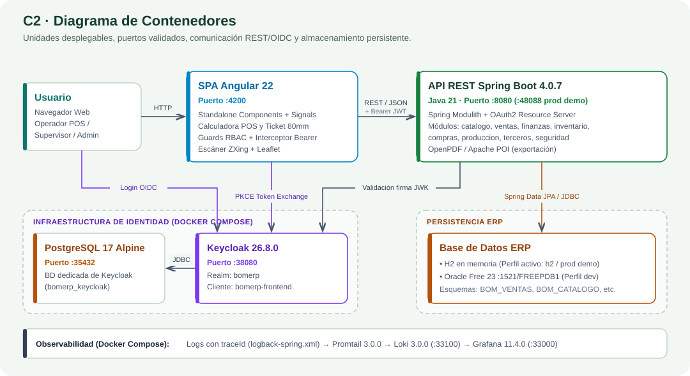

# Arquitectura C4 y despliegue

## C1 · Contexto

El personal de venta y administración utiliza el ERP. Keycloak entrega identidad y tokens; la consulta DNI/RUC usa un proveedor externo. El cliente compra en el proceso de negocio, pero no se le atribuye una aplicación de autoservicio.

## C2 · Contenedores

La SPA Angular y la aplicación Spring Boot son unidades distintas de ejecución. El backend usa JPA para persistencia. H2 es el entorno de laboratorio; Oracle es el destino empresarial previsto. PostgreSQL en el Compose guarda datos de Keycloak, no las ventas del ERP.

## C3 · Componentes de ventas

`VentaController` recibe DTO y contexto autenticado; `VentaServiceImpl` coordina reglas y transacción; `VentaRepository` persiste. El servicio se comunica con Catálogo e Inventario mediante servicios Java y con Finanzas mediante `FinanzasApi`. Estas colaboraciones suceden dentro de la aplicación, no mediante HTTP interno.

## Despliegue observado

| Unidad | Puerto de laboratorio | Fuente |
|---|---|---|
| Angular | 4200 | Entorno y comando de desarrollo |
| Spring Boot H2/dev | 8080 | Perfiles de aplicación |
| Keycloak | 38080 | Compose de desarrollo |
| Oracle | 1521 | Compose de desarrollo |
| PostgreSQL de Keycloak | 35432 en host | Compose de desarrollo |
| Grafana | 33000 y 3300 publicados | Compose de desarrollo |
| Loki | 33100 y 3100 publicados | Compose de desarrollo |

El Compose incluye Promtail y Grafana para observabilidad. Su presencia no demuestra que los paneles reciban datos: debe adjuntarse una consulta o captura de una ejecución.

## Límites de la arquitectura

Existe un único punto de arranque Spring Boot y una prueba `ApplicationModules.verify()`. La separación por paquetes y las interfaces nombradas expresan una intención modular. La conformidad completa exige ejecutar la prueba y revisar dependencias; no se declara que todos los límites ya estén verificados.

## Fuentes del proyecto

- [BomerpBackendApplication.java](https://github.com/B-randon36/AGROPERUVIANac/blob/41bd74a00342e5b28bb793a9bdc7221e3919fc3a/backend/src/main/java/pe/edu/upeu/bomerp/BomerpBackendApplication.java)
- [VentaServiceImpl.java](https://github.com/B-randon36/AGROPERUVIANac/blob/41bd74a00342e5b28bb793a9bdc7221e3919fc3a/backend/src/main/java/pe/edu/upeu/bomerp/ventas/service/VentaServiceImpl.java)
- [ModularityTests.java](https://github.com/B-randon36/AGROPERUVIANac/blob/41bd74a00342e5b28bb793a9bdc7221e3919fc3a/backend/src/test/java/pe/edu/upeu/bomerp/ModularityTests.java)
- [compose-dev.yml](https://github.com/B-randon36/AGROPERUVIANac/blob/41bd74a00342e5b28bb793a9bdc7221e3919fc3a/backend/compose-dev.yml)
