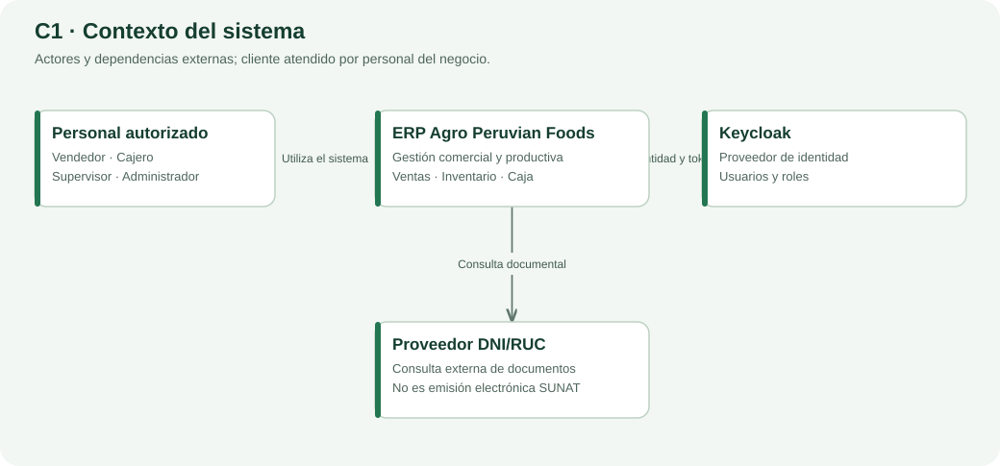
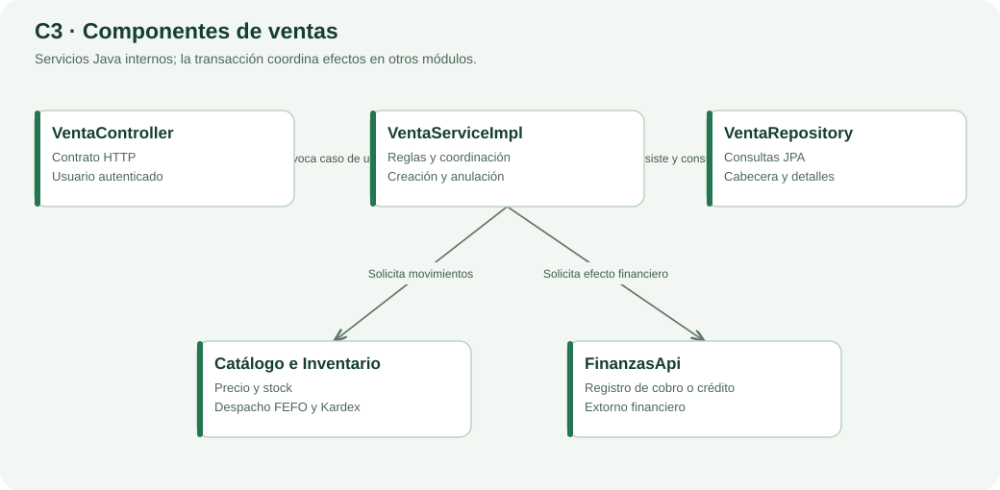

# Arquitectura C4 y Despliegue

El sistema **GDMERP (Agro Peruvian Foods)** sigue una arquitectura **Monolito Modular** basada en **Spring Modulith**, desacoplada mediante interfaces de servicio internas (`FinanzasApi`), seguridad federada OIDC con **Keycloak** y una aplicación web **SPA en Angular**.

---

## C1 · Diagrama de Contexto del Sistema

La vista C1 muestra la interacción entre los actores del negocio agroindustrial, el núcleo del sistema **GDMERP** y los sistemas externos de identidad y consulta DNI/RUC.

---

## C2 · Diagrama de Contenedores

La vista C2 detalla las unidades de ejecución desplegables del sistema, sus protocolos de comunicación y almacenamiento persistente.

---

## C3 · Diagrama de Componentes (Módulos Ventas ↔ Inventario ↔ Finanzas)

El núcleo comercial interactúa internamente dentro de la misma JVM mediante servicios e interfaces declaradas, garantizando atomicidad (`@Transactional`) sin latencia de red entre módulos.

---

## Puertos y Despliegue Validado

| Componente | Tecnología | Puerto | Rol en el Ecosistema |
|---|---|---|---|
| **Frontend Web** | Angular 22 (`npm start`) | `4200` | Interfaz POS, gestión de cajas, reportes y administración |
| **Backend ERP** | Spring Boot 4.0.7 / Java 21 | `8080` | API REST unificada, reglas de negocio y persistencia JPA (`48088` en perfil `prod` demo) |
| **Servidor OIDC** | Keycloak 26.8.0 (Docker) | `38080` | Emisión de tokens JWT y gestión de usuarios/roles (`bomerp`) |
| **BD Keycloak** | PostgreSQL 17 Alpine (Docker) | `35432` | Almacenamiento de usuarios, clientes y sesiones del IdP |
| **BD ERP (Default/Test)** | H2 Database (embebida) | En memoria | Perfil `h2` activo por defecto (`create-drop`) para desarrollo ágil y suite de 105 pruebas |
| **BD ERP (Oracle)** | Oracle Free 23 (`FREEPDB1`) | `1521` | Perfil `dev` en `application-dev.yml` y destino empresarial con secuencias dedicadas |
| **Observabilidad** | Grafana / Loki / Promtail (Compose) | `33000` / `33100` | Recolección centralizada de logs y métricas de contenedores |

## Límites Modulares (Spring Modulith)

La estructura de paquetes respeta el principio de **Monolito Modular**: un único artefacto desplegable (`BomerpBackendApplication`) dividido en dominios (`catalogo`, `ventas`, `finanzas`, `inventario`, `compras`, `produccion`, `terceros`, `seguridad`). La comunicación entre módulos utiliza interfaces públicas (como `FinanzasApi`, `ProductoService`, `InventarioService`) y paquetes expuestos mediante `@NamedInterface`, verificada automáticamente por `ModularityTests`.

## Fuentes del Proyecto

- [BomerpBackendApplication.java](https://github.com/B-randon36/AGROPERUVIANac/blob/main/backend/src/main/java/pe/edu/upeu/bomerp/BomerpBackendApplication.java)
- [VentaServiceImpl.java](https://github.com/B-randon36/AGROPERUVIANac/blob/main/backend/src/main/java/pe/edu/upeu/bomerp/ventas/service/VentaServiceImpl.java)
- [ModularityTests.java](https://github.com/B-randon36/AGROPERUVIANac/blob/main/backend/src/test/java/pe/edu/upeu/bomerp/ModularityTests.java)
- [compose-dev.yml](https://github.com/B-randon36/AGROPERUVIANac/blob/main/backend/compose-dev.yml)
