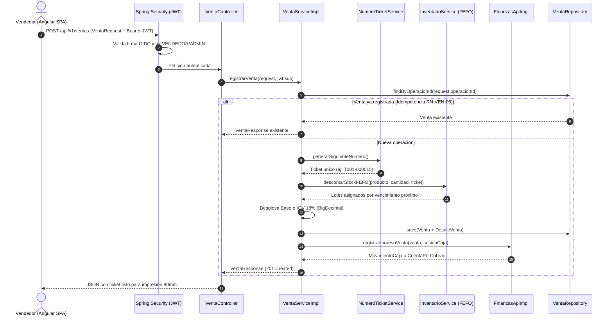
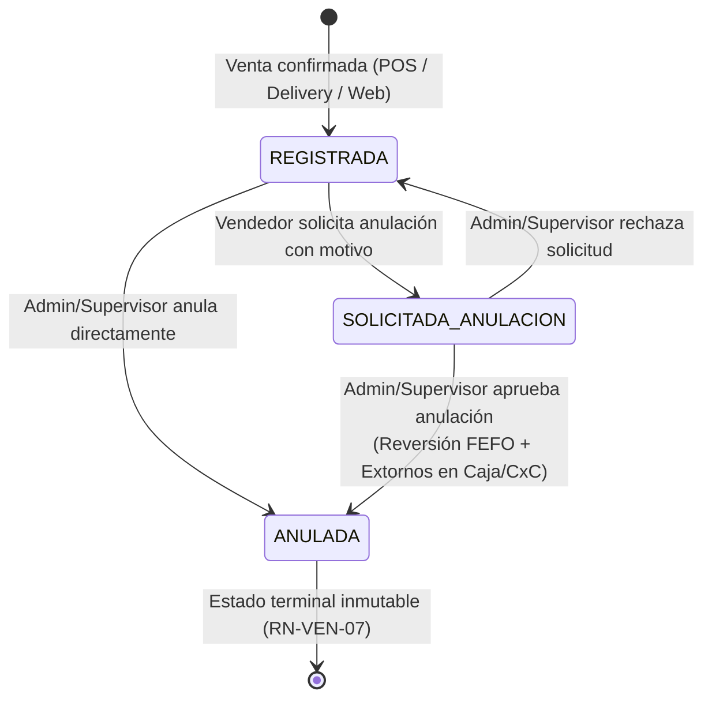

# Catálogo UML

## Clases Principales de Ventas

La composición entre `Venta` y `DetalleVenta` garantiza el ciclo de vida conjunto de la cabecera y sus líneas. El producto, el lote FEFO y la sesión de caja se vinculan por identificador, conservando el precio unitario y descripción vigentes al momento de la operación.

---

## Diagrama de Secuencia · Registro de Venta POS

---

## Máquina de Estados de la Venta (`EstadoVenta`)

### Reglas de Transición
- **Idempotencia (`RN-VEN-06`):** Si el cliente reenvía un `operacionId` ya procesado (por reconexión o doble clic), el servicio retorna la venta original sin duplicar ticket, stock ni movimientos de caja.
- **Segregación de Roles (`RN-VEN-07` / `RN-VEN-08`):** El vendedor puede solicitar anulación únicamente sobre sus propias ventas; solo un `SUPERVISOR` o `ADMIN` puede aprobar o rechazar la anulación.
- **Reversión Multilote FEFO (`RN-VEN-09`):** Al aprobarse la anulación, el sistema devuelve las cantidades exactamente a los lotes originales de donde salieron en orden de vencimiento, y genera el extorno financiero correspondiente.

---

## Fuentes del Proyecto

- [VentaController.java](https://github.com/B-randon36/AGROPERUVIANac/blob/main/backend/src/main/java/pe/edu/upeu/bomerp/ventas/controller/VentaController.java)
- [VentaServiceImpl.java](https://github.com/B-randon36/AGROPERUVIANac/blob/main/backend/src/main/java/pe/edu/upeu/bomerp/ventas/service/VentaServiceImpl.java)
- [EstadoVenta.java](https://github.com/B-randon36/AGROPERUVIANac/blob/main/backend/src/main/java/pe/edu/upeu/bomerp/ventas/entity/EstadoVenta.java)
