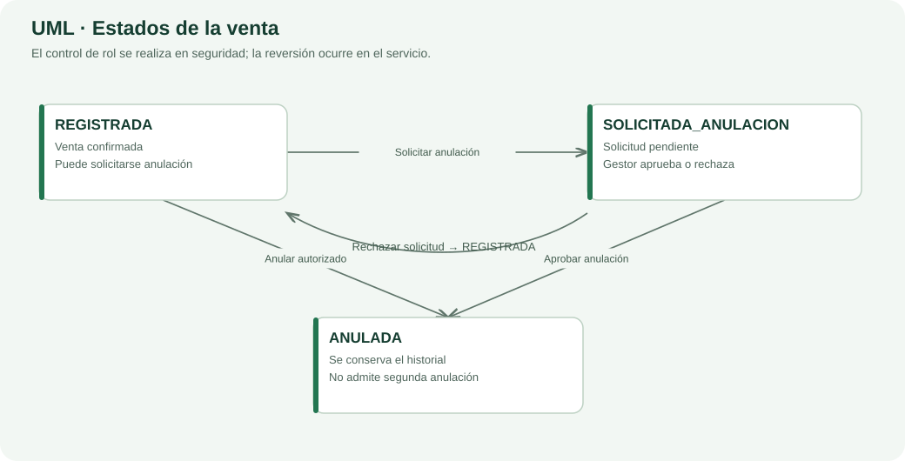

# Catálogo UML

## Clases principales de ventas

La composición representa la propiedad de los detalles por la cabecera. Producto, lote y sesión de caja se referencian por identificador. El precio unitario y el nombre se conservan en el detalle de venta para describir la operación registrada.

## Secuencia de registro

1. Angular envía `VentaRequest` a `POST /api/v1/ventas` con el token.
2. Spring Security evalúa autenticación y rol.
3. El controlador obtiene `sub` y llama al servicio.
4. El servicio revisa `operacionId`, obtiene ticket y datos de catálogo.
5. Solicita descuento de stock y despacho FEFO.
6. Crea detalles, calcula importes y guarda la cabecera.
7. Registra auditoría y efecto financiero.
8. Devuelve `VentaResponse`; la transacción se confirma si no aparece una excepción que determine rollback.

En un reintento detectado por `operacionId`, el método puede devolver la venta existente antes del resto del flujo. La comparación de contenido y propietario de ese reintento sigue siendo una revisión pendiente.

## Actividad comercial

Seleccionar productos → validar entrada → comprobar existencias → despachar → calcular → persistir y registrar finanzas → confirmar. Una excepción debe probarse como rollback de la operación completa; la anotación transaccional por sí sola no demuestra ese resultado para cualquier excepción.

## Estados de la venta

El servicio permite anular directamente una venta REGISTRADA a un actor autorizado; no exige siempre una solicitud previa. Rechazar solo tiene sentido desde SOLICITADA_ANULACION. Una venta ANULADA no puede volver a anularse.

Los diagramas delimitan el flujo de ventas y no sustituyen diagramas específicos de compras, producción o caja si se necesitan como evidencia individual.

## Fuentes del proyecto

- [VentaController.java](https://github.com/B-randon36/AGROPERUVIANac/blob/41bd74a00342e5b28bb793a9bdc7221e3919fc3a/backend/src/main/java/pe/edu/upeu/bomerp/ventas/controller/VentaController.java)
- [VentaServiceImpl.java](https://github.com/B-randon36/AGROPERUVIANac/blob/41bd74a00342e5b28bb793a9bdc7221e3919fc3a/backend/src/main/java/pe/edu/upeu/bomerp/ventas/service/VentaServiceImpl.java)
- [EstadoVenta.java](https://github.com/B-randon36/AGROPERUVIANac/blob/41bd74a00342e5b28bb793a9bdc7221e3919fc3a/backend/src/main/java/pe/edu/upeu/bomerp/ventas/entity/EstadoVenta.java)
